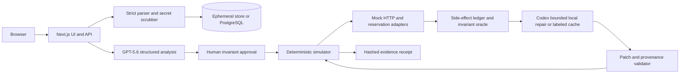

# RetryProof

**Break your automation before retries do.**

RetryProof is a deterministic retry-fault workbench for consequential n8n workflows. It imports an untrusted workflow export, removes credential references, rejects inline secrets, asks GPT-5.6 to propose a bounded reliability contract, and requires a human to approve that contract. A local simulator then proves what happens under declared faults. If the invariant fails, Codex prepares a reviewable hardening patch and regression fixture; the same deterministic scenario is rerun to produce red-to-green evidence.

> RetryProof provides deterministic evidence that a workflow satisfies a user-approved invariant under a declared fault model. It does **not** prove exactly-once execution, emulate arbitrary n8n behavior, or certify production safety. No real external action is performed.

> **Submission source of truth:** this repository is the standalone reference implementation and keeps its trusted-local/cached-production boundaries intact. The deployed OpenAI Build Week product is the integrated implementation in [`marmar9615-cloud/Copilot-Checker`](https://github.com/marmar9615-cloud/Copilot-Checker), served at [marmarlabs.com/retryproof/lab](https://marmarlabs.com/retryproof/lab/). That implementation adds the separate private Replit Codex worker, deployment access token, independent HMAC binding, signed progress stream, high-reasoning `gpt-5.6-sol` thread, trusted worker-side fixture binding, and ordered 300/330/360/390-second fail-closed timeout ladder. Submission claims and media are verified against the integrated product, not by pretending this reference server has those production capabilities.

## The two-refund failure

The included demonstration uses a synthetic refund webhook. Delivery one reaches `POST /refunds` and the mock refund succeeds, but its response is lost. The provider retries the same event. Before repair, the ledger records two refund effects for `evt_refund_001`; after a durable reservation is inserted, the identical two-delivery schedule records one.

| Evidence | Before repair | After repair |
|---|---:|---:|
| Deliveries | 2 | 2 |
| Refund effects for one event | 2 | 1 |
| Approved at-most-once invariant | Fail | Pass |
| Real network calls | 0 | 0 |

## Why GPT-5.6 and Codex are central

- **GPT-5.6** performs read-only semantic analysis over a canonical, sanitized graph. It identifies likely consequential writes, traces candidate business keys, and proposes structured invariants and supported scenarios. Its output is a proposal, never a verdict.
- **The user** approves or edits every invariant before it can run.
- **The deterministic simulator** owns pass/fail. It uses a logical clock, fixed seed, mock HTTP adapter, reservation store, side-effect ledger, and explicit invariant oracle.
- **Codex** receives only sanitized inputs in a bounded temporary workspace during an explicitly enabled trusted-local run. It emits a bounded JSON Patch, repair manifest, explanation, and regression fixture. A deterministic validator—not Codex—decides whether the result is acceptable. Production uses the labeled cached repair until live execution moves to a separately isolated worker.

This closed proof loop is the product; the models are not used as an ungrounded chat surface.

## Quick start

Requirements:

- Node.js 20 or later
- npm 10 or later
- An OpenAI API key for live GPT-5.6 analysis or live Codex repair
- PostgreSQL only for production persistence; local development defaults to an ephemeral in-memory store

```bash
# Run these commands from the checked-out RetryProof repository root.
npm ci
cp .env.example .env.local
npm run dev
```

Open [http://localhost:3000](http://localhost:3000) and select **Try refund demo**. The seeded path works in cached-model mode and keeps the simulator live.

Run the complete local verification set:

```bash
npm run lint
npm run typecheck
npm test
npm run eval:golden
npm run demo:rehearse
npm run build
```

The judged five-stage UI journey has a deterministic jsdom component test:

```bash
npm run test:e2e
```

## Configuration

Copy `.env.example` to `.env.local`. Never commit `.env.local` or expose a key with a `NEXT_PUBLIC_` prefix.

| Variable | Required | Values / purpose |
|---|---|---|
| `OPENAI_API_KEY` | Live modes only | Server-only OpenAI credential. |
| `OPENAI_ANALYSIS_MODEL` | No | Defaults to the verified `gpt-5.6-sol` model slug. |
| `CODEX_MODEL` | No | Defaults to the verified `gpt-5.6-sol` model slug. |
| `OPENAI_ORGANIZATION_ID` | No | Optional server-only organization routing header for live requests. |
| `OPENAI_PROJECT_ID` | No | Optional server-only project routing header for live requests. |
| `DEMO_MODEL_MODE` | No | `cached` or `live`; cached is clearly labeled in the UI and artifacts. |
| `CODEX_REPAIR_MODE` | No | `cached` or `live`; production permits only `cached`. |
| `CODEX_ALLOW_LOCAL_LIVE` | No | Must be `true` for live repair in a non-production trusted local environment. |
| `DATABASE_URL` | Production | PostgreSQL connection URL. Absence selects the local ephemeral store. |
| `DATABASE_POOL_SIZE` | No | Positive connection-pool size; defaults to 10. |
| `SESSION_SIGNING_SECRET` | Production | At least 32 random bytes. Rotate like a credential. |

Recommended local judge path:

```dotenv
DEMO_MODEL_MODE=cached
CODEX_REPAIR_MODE=cached
```

Recommended live integration check:

```dotenv
OPENAI_ANALYSIS_MODEL=gpt-5.6-sol
CODEX_MODEL=gpt-5.6-sol
DEMO_MODEL_MODE=live
CODEX_REPAIR_MODE=live
CODEX_ALLOW_LOCAL_LIVE=true
```

Add `OPENAI_API_KEY` directly to `.env.local` or the deployment secret manager without printing it in a terminal transcript.

With live credentials configured, verify each model boundary independently:

```bash
npm run verify:live:openai
npm run verify:live:codex
```

Both commands print only safe provenance and count metadata; they never print the key or full model payload.

Cached mode never implies a response was generated during the current run. The simulator, validator, and evidence hashing still execute locally.

## Supported surface

RetryProof accepts a strict n8n export envelope up to 1 MiB and supports a pinned, versioned subset of seven n8n node types: Webhook, Set, If, Switch, HTTP Request, a narrowly constrained PostgreSQL reservation query, and Respond to Webhook. Unsupported nodes on the tested path block execution; disconnected unsupported nodes remain visible in the compatibility report.

Fault scenarios are explicit and deterministic:

1. duplicate delivery;
2. effect succeeds, then the response times out;
3. rate limit before the effect, then retry;
4. partial failure after a node, then retry.

See [Supported surface](docs/SUPPORTED-SURFACE.md) for exact node versions, expression grammar, faults, and limitations.

## Security and privacy

- Raw uploads are parsed in memory and are never intentionally persisted.
- Credential references, notes, pin data, static data, tags, and metadata are removed.
- Suspected inline secrets cause the import to fail. Error output contains JSON paths, never secret values.
- Workflow fields are untrusted data, not model or Codex instructions.
- GPT-5.6 gets no shell, network, write, or credential tool.
- The simulator never opens a socket, runs arbitrary JavaScript, or executes arbitrary SQL.
- Trusted-local live Codex repair runs with network and approval disabled, a 60-second turn deadline, a 512 KiB output cap, and a constrained output contract. Its child receives a one-run loopback proxy token. Because a same-UID child can inspect parent process state on common Linux hosts, RetryProof rejects live Codex repair in production; process isolation is not claimed.
- Store-backed budgets cap live GPT-5.6/Codex calls in addition to per-session limits.
- Sanitized session data expires after 24 hours by default and may be deleted immediately.

Read [Security and threat model](docs/SECURITY.md) and [Privacy and retention](docs/PRIVACY.md) before using a proprietary workflow.

## Architecture



Detailed trust boundaries and request flows are in [Architecture](docs/ARCHITECTURE.md).

## Supported platforms

- Development and production: Node.js 20+ on macOS or Linux.
- Browser: current Safari, Chrome, Edge, or Firefox with JavaScript enabled.
- Deployment: a container-capable host plus PostgreSQL for durable sessions.
- Input: exported n8n workflow JSON matching the pinned support matrix.

Windows is not part of the judged support surface. Live Codex repair is a trusted-local development feature on Unix-like environments; the deployment path uses the labeled cached repair.

## Human decisions and Codex contribution

The essential human product and engineering decisions were to make a narrow claim, support only explicit node semantics, keep all effects mock-only, require approval before every invariant, and let a deterministic oracle—not a model—own the verdict. The same fault schedule must be rerun after repair, and every green artifact must repeat its limitations.

Codex accelerated repository scaffolding, implementation across the import/simulator/platform/UI boundaries, test generation, repair-contract design, documentation, and verification iteration. Those contributions remain reviewable in dated Codex sessions and commits. Before submission, the repository owner must record the `/feedback` Session ID containing the majority of the core implementation; that ID is intentionally not fabricated in this README.

## Repository map

```text
src/app/                 Next.js UI and API surface
src/domain/              Strict domain schemas
src/lib/n8n/             Parser, sanitizer, compatibility, canonicalization
src/lib/openai/          GPT-5.6 structured analysis and grounding
src/lib/simulator/       Deterministic world, adapters, scheduler, oracles
src/lib/codex/           Isolated repair agent and patch validation
src/lib/platform/        Sessions, rate limits, jobs, idempotency, persistence
src/lib/observability/   Privacy-safe audit and logs
database/migrations/     PostgreSQL schema
fixtures/demo/           Human-readable n8n demo inputs and contracts
fixtures/simulator/      Deterministic simulator fixtures
tests/                   Unit, integration, evaluation, and component-journey tests
scripts/                 Golden evaluation, rehearsal, and cleanup commands
docs/                    Architecture, support, deployment, demo, security
```

## Demonstration

The final submission video targets 2 minutes 45 seconds and is recorded from the integrated production lab, including the live private-worker progress feed and Fresh Codex provenance. See [Demo and fallback plan](docs/DEMO.md). The most important visual comparison is the same event, same seed, same fault phase, and same two deliveries changing from two effects (red) to one (green).

## Deployment

`Dockerfile` builds a minimal non-root Next.js production image, applies tracked migrations before startup, and exposes a schema-aware readiness route. `render.yaml` defines a web service and PostgreSQL database without storing credentials in source. Follow [Deployment](docs/DEPLOYMENT.md), including secret generation, live/cached mode selection, health checks, and a clean incognito rehearsal.

## Documentation

- [Architecture](docs/ARCHITECTURE.md)
- [Supported surface](docs/SUPPORTED-SURFACE.md)
- [API and error contracts](docs/API.md)
- [Security and threat model](docs/SECURITY.md)
- [Privacy and retention](docs/PRIVACY.md)
- [Deployment](docs/DEPLOYMENT.md)
- [Demo and fallback plan](docs/DEMO.md)
- [Evaluation](docs/EVALUATION.md)
- [Submission checklist](docs/SUBMISSION-CHECKLIST.md)

## Known limitations

- Evidence covers only the declared deterministic fault model, exact workflow snapshot, synthetic fixture, approved invariant, and supported node semantics.
- RetryProof does not execute n8n itself and is not a substitute for staging or production monitoring.
- Unsupported nodes are never approximated.
- The PostgreSQL contract supports only RetryProof's exact idempotency reservation query; arbitrary SQL is rejected.
- Narrow n8n expressions may read property paths rooted at `$json`; calls, operators, interpolation, globals, and arbitrary code are rejected.
- A stable business key and a durable reservation store remain deployment requirements.
- A generated patch requires human review before use in any real workflow.

RetryProof is not affiliated with or endorsed by n8n, Stripe, or any payment provider.

## License

MIT. See [LICENSE](LICENSE).
