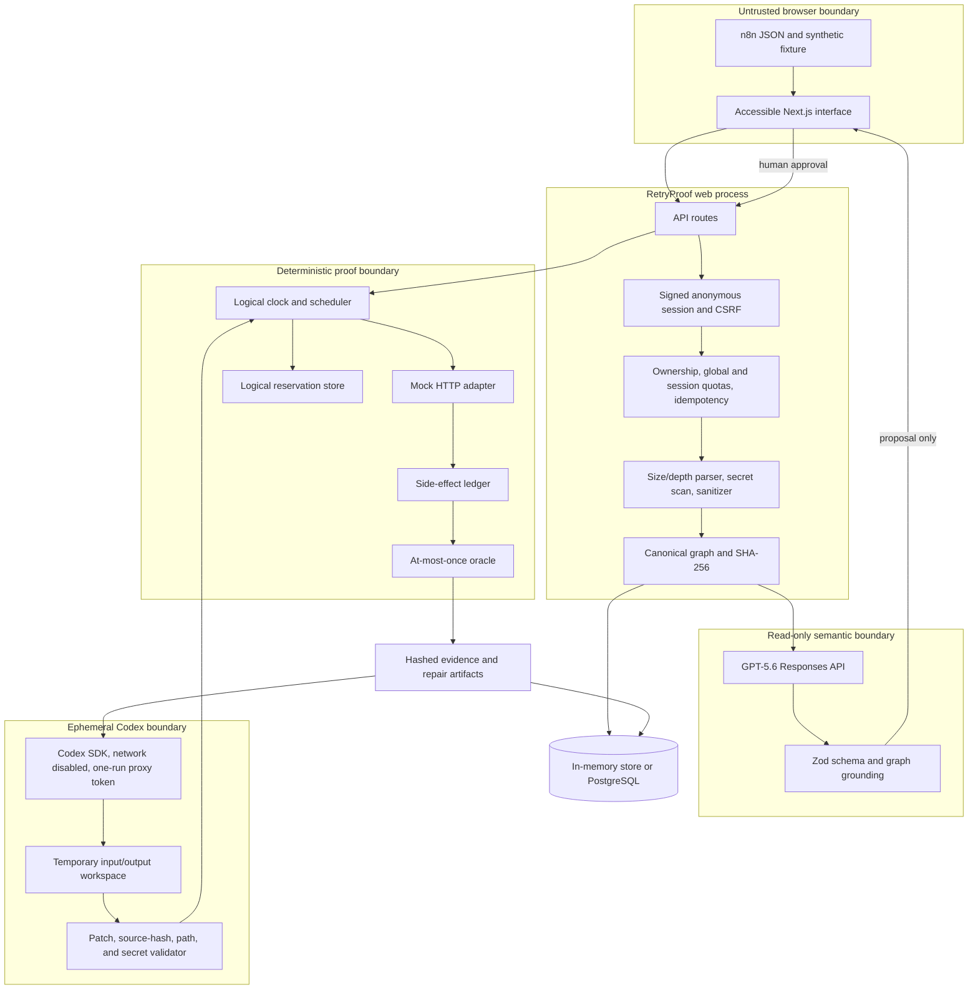
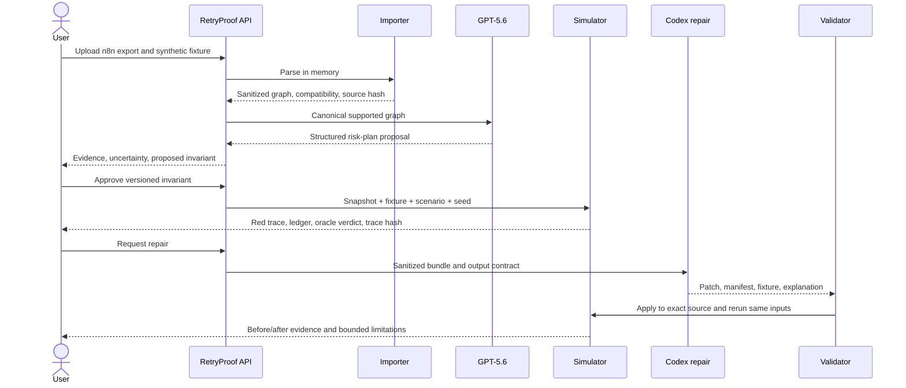

# RetryProof architecture

> This document describes the standalone reference implementation in this repository. The submitted production system is the integrated MarMar Labs implementation linked from the root README, with a separate private Replit Codex worker. Do not use the reference server's cached-production restriction to describe the deployed submission.

## Product boundary

RetryProof verifies a narrow statement:

> A specific sanitized workflow snapshot satisfies a user-approved invariant when executed by RetryProof's supported deterministic semantics under declared fault scenarios.

The simulator, not GPT-5.6 or Codex, owns the verdict. A green result is bounded evidence, not an exactly-once guarantee or production-safety certification.

## System view

## Trust boundaries and ownership

| Boundary | May do | Must not do |
|---|---|---|
| Importer | Parse strict JSON, report secret paths, strip references, canonicalize | Execute expressions, persist raw input, echo secret values |
| GPT-5.6 analyzer | Read the canonical supported graph; propose structured side effects, keys, invariants, scenarios | Run a scenario, approve a contract, write files, access credentials, decide pass/fail |
| Human | Approve or edit an invariant and repair | Be silently bypassed by a model result |
| Simulator | Execute supported domain nodes against deterministic mocks; record effects and verdicts | Open sockets, execute arbitrary JS/SQL, approximate unsupported nodes |
| Codex repair | Write declared artifacts in a temporary workspace | Modify the repository or source workflow directly, use the network, approve its own patch |
| Validator | Bind patch to source hash and approved invariant; reject unrelated or secret-bearing changes | Infer safety from prose or model confidence |
| Persistence | Store sanitized records, hashes, status, and bounded audit metadata | Store raw uploads, secrets, chain of thought, or real effect payloads in logs |

## Critical request flow

## Determinism

Every simulator run is a pure function of:

- workflow snapshot;
- simulation fixture;
- approved invariant;
- scenario including fault phase and delivery count;
- seed.

The world uses a logical clock and monotonically ordered trace events. HTTP routes are predeclared mocks. The side-effect ledger counts `effectId + key`, and the at-most-once oracle checks that the maximum is one. A suite and every trace receive deterministic hashes so an identical rerun can be compared directly.

## Persistence

Local development uses an in-memory store when `DATABASE_URL` is absent. Production uses PostgreSQL for signed anonymous sessions, short-lived workflow records, jobs, per-session and global rate-limit buckets, idempotency records, artifacts, and audit metadata. `npm run db:migrate` applies [001_initial.sql](../database/migrations/001_initial.sql), [002_lab.sql](../database/migrations/002_lab.sql), and [003_global_rate_limits.sql](../database/migrations/003_global_rate_limits.sql) in lexical order under an advisory lock and rejects changed applied files.

The job store claims queued work with a worker identity, tracks attempts, and reclaims stale work. Client-facing progress uses polling, avoiding a WebSocket dependency.

## Model modes

### Cached demonstration mode

`DEMO_MODEL_MODE=cached` and `CODEX_REPAIR_MODE=cached` use checked-in synthetic analysis/repair templates. Provenance labels must remain visible. The importer, human-approval gate, simulator, validator, and evidence hashing still run in the current process. This mode removes live API availability from the judged demonstration.

### Live mode

Live analysis uses the OpenAI Responses API with GPT-5.6 and strict Zod structured output. Grounding rejects invented node IDs, mismatched evidence-node paths, incompatible fault phases, unsupported claims, and any oracle key other than the supported `$.key`; the effect identifier is derived from cited HTTP graph evidence. Trusted-local live Codex repair uses the Codex SDK in a temporary directory with network and web search disabled. The child receives a random one-run token for a loopback-only Responses proxy, while the reusable OpenAI credential remains in the parent process. The proposal file is capped at 512 KiB before read and then validated against strict field limits. Production rejects this live mode because same-UID process boundaries are not credential isolation; deployed demonstrations use the accurately labeled cached repair.

Neither mode grants a model oracle authority.

## Why the architecture is intentionally narrow

RetryProof omits live n8n execution, real payment calls, arbitrary Code nodes, arbitrary SQL, and generic expression evaluation. Those omissions make the evidence more defensible: every red or green result maps to explicit code and declared semantics rather than an approximation hidden behind model output.
