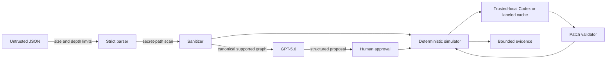

# Security and threat model

> This document describes the standalone reference implementation. The submitted production path preserves these product boundaries but moves live Codex into a separate private Replit worker protected by a deployment access token plus independent HMAC request/stream/candidate binding. Its production evidence is recorded in `submission/VERIFICATION.md`.

## Security objective

RetryProof must safely turn an untrusted automation export into bounded, reproducible evidence without executing user code, contacting user systems, leaking credentials, or letting a model define its own success.

## Assets

- workflow topology and operational metadata;
- synthetic fixture contents;
- OpenAI API key and database credentials;
- signed anonymous session;
- user-approved invariant and plan hash;
- source, patch, trace, and artifact hashes;
- deployment availability and model budget.

Raw uploads and real credentials are not product assets because RetryProof is designed not to retain them.

## Adversaries and failure sources

- a malicious upload attempting parser exhaustion or prototype pollution;
- an accidental inline secret in an n8n export;
- prompt injection embedded in names, notes, URLs, or fixture strings;
- a model inventing nodes, keys, facts, or a passing verdict;
- a Codex run changing unrelated nodes, writing outside its output contract, or adding secret material;
- a user attempting to target a real endpoint;
- cross-session resource access, CSRF, replay, or request flooding;
- a developer or judge over-reading simulated green evidence;
- transient OpenAI, Codex, database, or worker failure.

## Data-flow threats

## Controls by threat

| Threat | Preventive controls | Detection / recovery |
|---|---|---|
| Oversized, wide, or deeply nested JSON | Streaming 1 MiB cap independent of `Content-Length`, depth 64, 50,000-value traversal budget, node/edge caps, array index cap 256 | Typed error without body logging |
| Prototype pollution | Reject `__proto__`, `prototype`, `constructor` | Parser tests and JSON-path-only error |
| Arbitrary execution | Strict schemas; narrow `$json` paths; no eval; no Code nodes; no arbitrary SQL | Unsupported path blocks simulation |
| Credential leakage | Remove n8n credential references; reject suspected inline tokens and private keys before persistence/model calls | Report JSON path only; rotate if any secret reaches logs or source |
| Prompt injection | Treat all workflow fields as quoted data; strict structured outputs; graph-grounding checks; no GPT tools with writes/network/shell | Reject invented IDs/evidence; route uncertainty to user |
| Model as oracle | Human approval plus deterministic simulator/oracle | No model-produced pass/fail is accepted |
| Real-world effects | Predeclared mock routes; simulator has no socket adapter | Unknown route fails closed |
| Codex escape or unrelated change | Production live mode disabled; trusted-local mode uses a temporary directory, restricted child environment, no network/web search, one-run loopback proxy token, 60-second turn deadline, 512 KiB output cap, and exact RFC 6902 node/path/manifest contract | Reject wrong source hash, unrelated nodes/connections, undeclared runtime fields, secret-like values, or invalid artifacts |
| Cross-session access | Signed HttpOnly session cookie and ownership checks | 401/403 with privacy-safe audit event |
| CSRF / replay | SameSite cookie, CSRF token, `If-Match`, idempotency key + body hash | 409 on stale or conflicting replay |
| Denial of service | Session and CSRF checks before upload body reads, request/traversal limits, per-session budgets, store-backed live-model budgets, job caps, and timeouts | `429 Retry-After`; stale lock recovery |
| Evidence overclaim | Persistent limitation text in UI, receipts, README, and demo | Green is always scoped to snapshot + invariant + scenarios + seed |

## Prompt-injection boundary

The following are untrusted data, even when they look like instructions:

- workflow and node names;
- notes;
- URLs and header names;
- mappings and expressions;
- fixture strings;
- model-generated explanations.

The analyzer receives a fixed system prompt and a serialized canonical graph. It may only return the strict risk-plan schema. Grounding verifies that every cited node and evidence path exists, derives effect IDs from cited HTTP nodes, pins the supported oracle key to `$.key`, checks scenario phases, and requires human approval for every invariant.

For an explicitly enabled trusted-local check, Codex receives a separate `AGENTS.md`, sanitized input, an expected source hash, and an output schema. No text inside a workflow is granted instruction priority. The child receives only an ephemeral loopback proxy credential; the reusable OpenAI API key stays in the parent process. This is a containment layer, not same-UID credential isolation, so the production server rejects live Codex repair.

## Secret-handling procedure

1. Never paste or commit API keys.
2. Store local credentials in `.env.local` with restrictive filesystem permissions.
3. Store production credentials only in the deployment secret manager.
4. Never prefix a server credential with `NEXT_PUBLIC_`.
5. Logs contain request IDs, hashes, timings, counts, and error codes—not bodies.
6. If a credential appears in terminal output, source control, logs, screenshots, or a model request, revoke and rotate it immediately.
7. Run a repository secret scan before making the repository public.

## Authorization and approval boundaries

- Anonymous sessions are capability boundaries, not identities.
- Every workflow, job, analysis, execution, and artifact is bound to one session.
- Every state-changing request requires a valid session and CSRF proof.
- Every invariant requires an explicit approval timestamp and plan hash.
- A repair remains review-only until the user approves it.
- A recheck is bound to the exact owned repair ID, repaired workflow, analysis, and receipt hash requested by the user.
- RetryProof never deploys a workflow or connects to a production n8n account.

## Residual risks

- Secret detection is heuristic and cannot find every proprietary value.
- Simulation may diverge from a deployed n8n version or provider behavior.
- A valid stable key may not be durable or unique in production.
- A generated patch may still be inappropriate for the user's storage topology.
- Live Codex and GPT-5.6 inherit availability and policy dependencies from their services.
- Live Codex repair is restricted to explicit trusted-local, non-production runs because a same-UID child process is not a credential-isolation boundary. Production uses only the accurately labeled cached repair until a separately isolated worker is available.

These risks are why every artifact states that the result is not exactly-once or production-safety proof.

## Reporting a security issue

Do not include real workflow exports or credentials in a public issue. Provide a minimal synthetic reproduction, affected version, expected boundary, and observed behavior. Rotate any credential that may have been exposed before sending a report.
